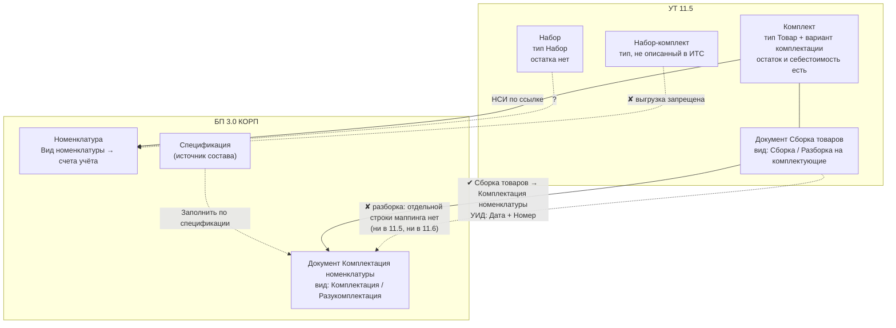

[← Оглавление](index.html) · [2. УТ: комплекты](<02-ut-komplekty.html>)

## 1. Главная карта: четыре сущности, которые путают

В этом контуре **четыре** разных объекта, а не один. Половина проектов «учёта
комплектов» ломается потому, что заказчик хочет «чтобы комплект был», а под этим
подразумевает в разные минуты разные из четырёх.

| | **Комплект** | **Набор** (динамический) | **Набор-комплект** | **Комплектация номенклатуры** |
|---|---|---|---|---|
| Где живёт | УТ 11.5 | УТ 11.5 | УТ/КА/ERP | БП 3.0 |
| Это | номенклатура типа `Товар` + **вариант комплектации** | номенклатура типа `Набор` | тип номенклатуры | **документ** (2 вида операции) |
| Физическая сборка на складе | **да**, документом `Сборка товаров` | **нет** | — | да, документом |
| Остаток на складе | есть, как у обычного товара | **нет** (лежат комплектующие) | — | есть |
| Себестоимость/цена | комплект = сумма себестоимостей комплектующих | цена **складывается из цен комплектующих** (или распределяется) | — | по **сумме себестоимостей**; обратно — **долей** |
| Перенос в БП | документом `Сборка товаров → Комплектация номенклатуры` | **в ИТС не описан** | **запрещён** | это и есть БП-сторона |

Цитаты-опоры:

> «Информация о комплекте заполняется в справочнике Номенклатура. **Для комплекта
> используется тип номенклатуры Товар**.» — `ut8doc/339` (релиз 11.5.22, ваш)

> «**Набор – комплекты, которые не хранятся на складе, а собираются в процессе
> отгрузки.**» — `ut115doc/798` (программная документация УТ 11.5)

> «**Комплектация – объединение нескольких товаров в один комплект. Разукомплектация
> – разделение комплекта на отдельные товары.**» — `bp8doc/160`

> «**НЕ поддерживается выгрузка из ERP (КА, УТ) элементов справочника Номенклатура
> с типом Набор-комплект.**» — `ut115doc/1585`

Архитектурная формулировка, которую стоит повесить над рабочим столом:

* **в УТ комплект — это складская операция** (нужен документ сборки, появляется
  остаток и себестоимость);
* **в УТ набор — это способ продажи и ценообразования** (никакого объекта склада
  не возникает);
* **в БП «набора» нет вообще** — там только бухгалтерская операция комплектации.

---

