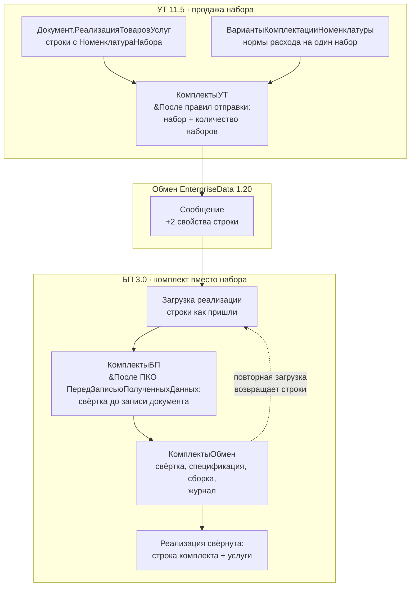

# План работ: автоматическая свёртка наборов УТ в комплекты БП

**Дата:** 04.11.2026. **Базы:** УТ 11.5.22.186 ↔ БП 3.0.208.14, платформа 8.3.27.2342.
**Основание:** постановка «набор продаём в УТ, в бухгалтерии нужен комплект» (§5.13,
§7.8 книги) и уточнение 04.11.2026: **процесс должен быть полностью автоматическим
и незаметным для пользователя** — сейчас эту работу бухгалтер делает руками, компания
просит её автоматизировать, а не изменить.

Документ — рабочий, не публикуется на сайт. Ссылки на протоколы — в `cfg/`,
на главы — в `docs/`.

---

## 0. Постановка и границы

### 0.1. Что автоматизируем

Сегодня бухгалтер после загрузки реализации из УТ делает в БП четыре действия:

1. создаёт документ `Комплектация номенклатуры` (вид операции «Комплектация»),
   указывает комплект, количество и комплектующие;
2. создаёт `Спецификацию номенклатуры` для этого комплекта (состав проданного набора);
3. проводит сборку — комплект встаёт на склад, комплектующие списываются;
4. заменяет в загруженной реализации товарные строки набора одной строкой комплекта,
   сохраняя сумму, НДС и счета, и проводит документ.

Автоматизация повторяет ровно эти четыре шага и ничего не добавляет к поведению
документа. Ни менеджер в УТ, ни бухгалтер в БП не должны узнать, что между базами
появился ещё один участник.

### 0.2. Что значит «незаметно» — критерии приёмки

| № | Критерий | Как проверяем |
|---|---|---|
| U1 | В обычном сценарии бухгалтер не нажимает новых кнопок | после загрузки обмена документ уже свёрнут и проведён |
| U2 | В УТ менеджер не заполняет ничего нового, формы не изменились | сравнение формы реализации до/после установки расширения |
| U3 | Ни один новый реквизит не виден на форме | добавленные реквизиты не размещены на форме, видны только в конфигураторе |
| U4 | Документ в БП выглядит как после ручной работы | одна строка комплекта, своя спецификация и сборка, те же проводки |
| U5 | Сбой обработки не ломает обмен | документ остаётся как пришёл, запись в журнале, повтор при следующем прогоне |
| U6 | Наши объекты не уезжают обратно в УТ | в УТ нет дублей номенклатуры и лишних сборок |
| U7 | Откат не требует удаления данных | повторная загрузка из УТ + повторная обработка восстанавливают результат |
| U8 | Закрытый период не трогаем | документ до даты запрета не изменяется, запись в журнале |

«Незаметно» не означает «без журнала»: журнал есть, но он для разбора сбоев, а не
для ежедневной работы.

### 0.3. Худший случай — это норма, а не ограничение пользователя

Мы не управляем содержимым документа и не имеем права его ограничивать. Поэтому
алгоритм обязан работать на любой комбинации:

- несколько наборов в одном документе, у каждого своя карточка комплекта и своё
  количество;
- наборы и обычные товары вперемешку в одной табличной части;
- услуги в отдельной табличной части `Услуги`;
- набор, внутри которого есть услуга;
- разные ставки НДС внутри одного набора;
- повторная загрузка того же документа и две продажи одного набора в один день.

Во всех случаях набор сворачивается, обычный товар и услуга — нет. Ни один сценарий
не требует от пользователя «не делай так».

### 0.4. Чего в плане нет

- правки типовых правил обмена «в лоб» (снимать с поддержки не будем);
- собственного плана обмена (запрещено стандартом #std771);
- требования к дисциплине пользователя (пометок, обязательных полей, отдельных
  документов);
- ручного подтверждения каждой реализации как штатного режима.

---

## 1. Отправная точка: что уже проверено

| Факт | Где подтверждено |
|---|---|
| В УТ строка знает свой набор: `НоменклатураНабора`, `АналитикаУчетаНаборов` | `cfg/EVIDENCE-2026-11-03-versii.md` §1 |
| В обмен уходят 11 полей строки; набора и количества среди них нет | там же §2 |
| Название набора попадает только в `Комментарий`, если его вписал человек | там же §4 |
| «Версия набора» — это `ВерсияДанных`, к составу не привязана, в обмен не входит | там же §3 |
| Модель «одна карточка + спецификация и сборка на каждую продажу» работает | `cfg/EVIDENCE-2026-11-03-spec-na-prodazhu.md`, `...-tk14.md` |
| Услуга приезжает в отдельной ТЧ `Услуги` и не сворачивается | `cfg/EVIDENCE-2026-11-04-uslugi-i-srednyaya.md` |
| Повторная загрузка возвращает документу исходные строки | там же, §5.13 книги |
| Созданная в БП номенклатура уезжает в УТ дублем | `cfg/EVIDENCE-2026-11-03-nabor-komplekt.md` |
| В варианте комплектации УТ услуг нет (0 вхождений) | grep по `Catalogs/ВариантыКомплектацииНоменклатуры.xml` |
| Носитель пометки — существующее ПКО `Документ.РеализацияТоваровУслуг` в обоих менеджерах | УТ: 32877/56750, БП: 12411/12537 |
| `ЗафиксироватьЗавершениеОбмена` и `ДобавитьПКО_…` — экспортируемые методы общих модулей | `ОбменДаннымиСервер` БП:5904; менеджеры обеих баз |
| Совместимость обеих конфигураций — `Version8_3_27` | `Configuration.xml` выгрузок |

Чего **не** проверено и что выносится в спайки (§9.0): аннотации `&После` на общих
модулях, загрузка одного расширения в обе базы, добавление реквизита в ТЧ
заимствованного документа, обратная регистрация объектов, свойство в XDTO через
аннотацию.

---

## 2. Архитектура: три расширения

### 2.1. Состав

| Расширение | Где стоит | Что содержит | Чего в нём нет |
|---|---|---|---|
| **`КомплектыОбмен`** (общее) | **в обеих базах** | модель данных, алгоритм свёртки, чтение пометки, журнал, настройки, справка, XDTO-пакет | ни одного заимствованного объекта, кроме `ОбменДаннымиПереопределяемый` (есть в обеих базах и нужен для регистрации формата) |
| **`КомплектыУТ`** | только УТ | `&После` для правил отправки, расчёт количества наборов, проверка состава, тесты УТ | бизнес-логики свёртки |
| **`КомплектыБП`** | только БП | `&После("ПКО_Документ_РеализацияТоваровУслуг_ПередЗаписьюПолученныхДанных")` в заимствованном `МенеджерОбменаЧерезУниверсальныйФормат13`, реквизиты в ТЧ `Товары`, тесты БП | бизнес-логики свёртки |

Правило, которое держит архитектуру: **всё, что описывает «что делать», живёт в
общем расширении; всё, что знает «где именно в этой конфигурации лежит кнопка или
поле», — в персональном.** Персональное расширение не содержит алгоритма, только
адаптер.

### 2.2. Схема



### 2.3. Почему не одно расширение и не копия кода

Одно расширение, установленное в обе базы, невозможно: оно должно заимствовать
объекты, которых в другой базе нет (менеджер конвертации называется по-разному,
формы разные). Копия кода в двух персональных расширениях расходится на второй
правке. Три расширения дают одну точку изменения алгоритма и две тонкие точки
адаптации, каждая из которых проверяется своим набором тестов.

### 2.4. Как персональное расширение вызывает общее

Вызов по имени общего модуля: `КомплектыОбмен_Свертка.ОбработатьДокумент(...)`.
Общие модули расширений доступны в контексте сервера; конкретный способ (прямой
вызов, `Вычислить`), совместимость имён и поведение при отключённом общем
расширении проверяются спайком S2. Если прямой вызов между расширениями не
работает, адаптер получает копию имени метода в своей константе и вызывает через
`Вычислить("КомплектыОбмен_Свертка.ОбработатьДокумент(...)")` — это уже отлаженный
в проекте приём (`tools/1c/diag/Обмен`).

---

## 3. Канал данных: откуда берётся пометка набора

### 3.1. Проблема

В сообщении нет ни ссылки на набор, ни количества наборов. Без них нельзя ни
опознать карточку комплекта, ни понять, сколько комплектов создать. Догадка по
составу возможна, но требует реестра составов, который сам должен как-то попасть
в БП.

### 3.2. Один источник пометки: формат обмена

Заказчик сузил задачу: алгоритм работает **только при получении документа через
обмен**, других задач у него нет. Значит и источников пометки ровно один —
свойства, которые приходят в сообщении. Цепочка `Формат` → `Реестр` → `Ручной`
из первой редакции плана отменена: она существовала ради ручного ремонта и
страховки по составу, а ремонта в постановке нет.

Модуль `КомплектыОбмен_Пометка` читает из полученной таблицы `Товары` две
колонки и возвращает таблицу групп:

| Колонка | Смысл |
|---|---|
| `КлючГруппы` | стабильный ключ группы строк (УИД набора из сообщения) |
| `Строки` | массив номеров строк документа, входящих в группу |
| `Набор` | идентификатор набора, как он пришёл из УТ |
| `КоличествоНаборов` | сколько наборов в строке |

Строк без пометки модуль не трогает вообще. Если пометки нет ни у одной строки,
алгоритм не вызывается — документ записывается как пришёл.

### 3.3. Почему формат — обязательный этап, а не опция

Требование «полностью автоматически» несовместимо с «оператор укажет карточку».
Без свойств в сообщении опознать набор нечем, поэтому этап F (расширение формата)
входит в обязательный контур. Провайдера «по составу» нет: он даёт ложные
срабатывания, когда тот же набор товаров продан не набором, и требует отдельной
синхронизации составов.

### 3.4. Минимальный формат: два свойства

Передаём ровно два значения на строку `Товары`:

| Свойство | В УТ | В БП |
|---|---|---|
| `Набор` | `НоменклатураНабора` (реквизит есть) | новый реквизит `КомплектыОбмен_Набор` в ТЧ `Товары` |
| `КоличествоНаборов` | вычисляется по варианту комплектации при отправке | новый реквизит `КомплектыОбмен_КоличествоНаборов` |

Свойства добавляются в существующее ПКО `Документ_РеализацияТоваровУслуг`
(УТ:32877, БП:12411/12537), новый объект формата не вводится. Имена и порядок
свойств в XDTO-пакете на обеих сторонах обязаны совпадать.

### 3.5. Как это делается без копирования менеджера

Вместо заимствования 83 364 строк УТ-менеджера (55 492 в БП) с полной правкой:

- XDTO-пакет-расширение (наследует `EnterpriseData_1_20_2` через `xs:import`) —
  собственный объект **общего** расширения;
- регистрация пакета — `&После("ПриПолученииДоступныхРасширенийФормата")` в
  заимствованном `ОбменДаннымиПереопределяемый` (общее расширение);
- правила — `&После("ДобавитьПКО_Документ_РеализацияТоваровУслуг_Отправка")` в УТ
  и `&После("ДобавитьПКО_Документ_РеализацияТоваровУслуг")` в БП; обработчик
  находит заполненное правило по `ИмяПКО` и вызывает `ДобавитьПКС(...)` с
  namespace расширения.

Fallback (заимствование менеджера целиком, как в статье ИТС `metod8dev/6013`)
**не нужен**: спайк S1 (04.11.2026) подтвердил, что `&После` на заимствованном общем
модуле работает — см. `cfg/EVIDENCE-2026-11-04-spike-s1-perehvat.md`.

### 3.6. Подавление обратной выгрузки

Созданные в БП карточка комплекта, спецификация и сборка не должны уезжать в УТ:
сейчас номенклатура уезжает дублем (подтверждено). Меры: после записи снимать
регистрацию изменений наших объектов и проверять, что в сообщении БП→УТ их нет.
Конкретный механизм (`ПланыОбмена.УдалитьРегистрациюИзменений` либо настройка
состава плана на стороне БП) — спайк S4. Критерий: после прогона в УТ не
появилось ни одной новой номенклатуры и ни одной сборки.

---

## 4. Модель данных общего расширения

Все объекты — собственные, с префиксом `КомплектыОбмен_`. Состав сокращён под
один сценарий: очередь, провайдеры и ручной ремонт убраны (решение 04.11.2026).

| Объект | Тип | Назначение | Ключ / особенности |
|---|---|---|---|
| `КомплектыОбмен_Справка` | справочник | справочные материалы, читаемые человеком и моделью | `Код` (имя файла), `Заголовок`, `Текст` (строка неограниченной длины), `ДляКого`, `Порядок` |
| `КомплектыОбмен_СостояниеОбработки` | перечисление | Обработан / Пропущен / Ошибка | — |
| `КомплектыОбмен_ЖурналОбработки` | регистр сведений | что и чем закончилось, идемпотентность | измерения: `Документ`, `КлючГруппы`; ресурсы: `Карточка`, `КоличествоНаборов`, `Спецификация`, `Сборка`, `Состояние`, `Сообщение`, `ВерсияДокумента`, `Обработано` |
| `КомплектыОбмен_СоответствиеНаборов` | регистр сведений | кэш «набор из УТ → карточка комплекта в БП» | измерение `НаборУИД`; ресурсы `НаборНаименование`, `Карточка`, `Создана` |
| `КомплектыОбмен_Настройки` | регистр сведений | настройки контура | `СоздаватьКарточки`, `ДатаЗапрета` |
| `КомплектыОбмен_Справка` | общий макет | упакованный текст справки | собирается генератором из `docs/*.md` |
| `КомплектыОбмен_ПрогонТестов` | обработка (внешняя) | прогон сценариев на базе | не входит в `.cfe`, лежит в репозитории |

Подсистемы, формы и команды в расширение **не входят**: в интерфейсе не должно
появиться ничего (критерий U1). Управление — только настройки в регистре,
изменяемые администратором.

Общие модули:

| Модуль | Ответственность |
|---|---|
| `КомплектыОбмен_Свертка` | чистый алгоритм: вход — документ + группы, выход — план замены; без обращений к формам |
| `КомплектыОбмен_Сервер` | фасад: `ОбработатьПолученныйДокумент(ПолученныеДанные, КомпонентыОбмена)` |
| `КомплектыОбмен_Пометка` | чтение двух колонок из полученной таблицы |
| `КомплектыОбмен_Карточки` | создание и поиск карточки комплекта, спецификации, сборки |
| `КомплектыОбмен_Журнал` | запись состояний и ошибок |
| `КомплектыОбмен_Настройки` | чтение настроек, дата запрета |
| `КомплектыОбмен_Справка` | выдача текстов для макета |
| `КомплектыОбмен_ПовтИсп` | кэш настроек и соответствий на сеанс |

Идемпотентность: ключ — `УИД документа` + `КлючГруппы`. Повторный приём того же
документа не создаёт второй комплект: прежняя сборка находится по ключу записи
журнала, распроводится, состав обновляется, проводится заново. Лишние группы
(набор убрали из документа) — распроводятся и помечаются на удаление с записью
в журнал.

---

## 5. Алгоритм на худшем случае

Вход: объект `ДокументОбъект.РеализацияТоваровУслуг`, подготовленный загрузкой
обмена, но **ещё не записанный**. Выход — тот же объект с заменёнными строками;
записывает его штатный код обмена сразу после нас.

1. **Отсечки.** Документ до `ДатаЗапрета` — пропуск с записью `Пропущен`.
   Признак «документ уже обрабатывался» — запись журнала по УИД документа;
   повторный приём не создаёт вторых объектов, а обновляет найденные.
2. **Группы.** Прочитать две колонки пометки из полученной таблицы. Строки без
   пометки — обычные товары и услуги, дальше не трогаются.
3. **Карточка.** Найти в `КомплектыОбмен_СоответствиеНаборов` по УИД набора; если
   нет и `СоздаватьКарточки` включено — создать номенклатуру с видом «Товары» и
   признаком «Комплектуем», записать соответствие. Если карточки нет и создавать
   запрещено — группа пропускается, документ остаётся как пришёл.
4. **Количество.** Из пометки. Если не заполнено — считается 1 и в журнал пишется
   предупреждение: молча не додумываем.
5. **Состав одного набора.** Количество строки ÷ количество наборов. Если не
   делится нацело — количество наборов считается 1, в журнал пишется
   предупреждение, состав берётся как есть.
6. **Спецификация.** Найти прежнюю по ключу; иначе создать. Владелец — карточка
   комплекта, состав — нормы одного набора.
7. **Сборка.** `КомплектацияНоменклатуры`, дата — на секунду раньше даты продажи,
   организация и склад — из документа, комплект — карточка, количество — число
   наборов, комплектующие — нормы × число наборов. Прежнюю сборку обновить, а не
   создавать вторую.
8. **Проверки.** Остатков комплектующих может не хватить: сборка всё равно
   создаётся (как у человека), в журнал — предупреждение; блокировки нет.
9. **Замена строк.** Для каждой группы: сохранить сумму, ставку НДС, счета учёта,
   доходов, расходов, НДС, субконто, единицу и коэффициент первой строки; удалить
   строки группы; вставить строку комплекта. **По одной строке на ставку НДС**,
   если ставки в группе разные; цена = сумма ÷ количество наборов.
10. **Итоги.** Пересчитать `СуммаДокумента` = товары + услуги. Запись и
    проведение выполняет штатный код обмена; собственной записи документа нет —
    иначе документ попадёт в базу дважды.
11. **Журнал.** Строка на каждую группу + итог по документу.
12. **Обратный поток.** Созданные карточка, спецификация и сборка не должны
    попасть в сообщение БП→УТ (U6). Механизм — спайк S4; делается после записи
    объектов, до завершения сеанса обмена.

Правила, которые не обсуждаются в коде:

- услуга не сворачивается никогда, даже если помечена как часть набора;
- обычный товар не сворачивается никогда;
- строка комплекта наследует счета и субконто первой строки своей группы;
- количество наборов никогда не «додумывается» молча — либо точное, либо с
  пометкой в журнале.

Матрица сценариев (она же основа тестов, §8):

| # | Документ | Ожидание |
|---|---|---|
| W1 | 1 набор | 1 строка комплекта, 1 спецификация, 1 сборка |
| W2 | 2 разных набора | 2 строки, 2 карточки, 2 спецификации, 2 сборки |
| W3 | 2 набора + обычный товар | 3 строки: комплект, комплект, товар |
| W4 | набор + услуга в ТЧ `Услуги` | комплект + услуга |
| W5 | набор, внутри которого услуга | комплект из товаров + услуга отдельно |
| W6 | 3 набора, один в 2 шт | 3 строки, у одной количество 2 |
| W7 | разные ставки НДС внутри набора | строка комплекта на каждую ставку |
| W8 | 2 набора + товар + 2 услуги | 5 строк, сворачиваются только наборы |
| W9 | обычная продажа тех же товаров без пометки | не тронута: пометки нет — алгоритм не вызывается |
| W10 | тот же набор дважды в один день | две спецификации, две сборки, одна карточка |
| W11 | повторная загрузка после обработки | прежние объекты обновлены, дублей нет |
| W12 | документ в закрытом периоде | не изменён, запись `Пропущен` |

---

## 6. Запуск: единственная точка — загрузка обмена

### 6.1. Место перехвата

Главное требование заказчика — **пользователь не должен заметить, что что-то
происходит**, и алгоритм работает **только** при получении документа обменом.
Поэтому точка одна и она внутри загрузки:

`КомплектыБП` заимствует общий модуль
`МенеджерОбменаЧерезУниверсальныйФормат13` и добавляет

```bsl
&После("ПКО_Документ_РеализацияТоваровУслуг_ПередЗаписьюПолученныхДанных")
Процедура КомплектыБП_ПередЗаписьюПолученныхДанных(ПолученныеДанные, ДанныеИБ, КонвертацияСвойств, КомпонентыОбмена)
```

Штатная точка правил конвертации БП (`ПравилоКонвертации.ПередЗаписьюПолученныхДанных`,
менеджер:12411/31079). К моменту вызова документ уже собран из сообщения и
заполнен, но **ещё не записан**; запись и проведение выполняет штатный код обмена
сразу после возврата из обработчика.

Что это даёт:

- нет ни одной секунды, когда документ лежит в базе «сырым»;
- ручное создание реализации в БП не затрагивается вообще — перехватчика на
  форме и на модуле документа нет;
- нет очереди, фоновых заданий и периода ожидания;
- если обработчик упал, документ записывается как пришёл (штатный код обмена не
  отменяется), ошибка остаётся в журнале — критерий U5.

Атомарность: `Комплектация номенклатуры` пишется внутри той же транзакции, что и
реализация. Если запись реализации не удалась, сборка откатывается вместе с ней.

Работоспособность механизма (вложенная запись документа из этого обработчика
внутри загрузки обмена) — спайк **S6**, до этапа D.

### 6.2. Запреты

- закрытый период (`ДатаЗапрета`) — документ не трогаем, запись `Пропущен`;
- документ изменён после обработки вручную — не перезаписываем;
- если в документе нет ни одной группы — ничего не делаем и не пишем в журнал;
- никакого ремонта старых документов: загруженные до установки расширения
  остаются как есть, при повторном приёме того же документа сработает обычный
  алгоритм.

---

## 7. Справочные материалы внутри общего расширения

Требование: материал читает и человек, и модель. Значит исходник — обычный
markdown в репозитории, а в расширение он попадает упакованным.

Каталог: `tools/1c/ext/КомплектыОбмен/docs/`

| Файл | Содержание | Для кого |
|---|---|---|
| `00-назначение.md` | зачем контур, что делает и чего не делает | человек, модель |
| `01-установка.md` | три расширения, порядок установки, проверка после установки | человек |
| `02-модель-данных.md` | объекты, поля, связи, ключи идемпотентности | модель |
| `03-алгоритм.md` | шаги §5, матрица W1–W12, точки принятия решений | модель |
| `04-пометка-набора.md` | два свойства сообщения, как добавить третье | модель |
| `05-журнал-и-ошибки.md` | коды состояний, что делать по каждому | человек |
| `06-тесты-общие.md` | сценарии и порядок прогона на любой стороне | человек, модель |
| `07-обновление-конфигураций.md` | что проверить после обновления УТ и БП | человек, модель |
| `08-промт-для-модели.md` | готовый промт сопровождения | модель |
| `09-глоссарий.md` | набор, комплект, вариант комплектации, свёртка | человек |

Упаковка: `tools/build/help-pack.py` читает `docs/*.md` и собирает
`Справочник.КомплектыОбмен_Справка` (по разделу на файл) плюс `ОбщийМакет`
(сводный текст). Один источник — два представления, расхождений нет. Форм и
команд у справочника нет: он читается обработкой диагностики и моделью из
репозитория, в интерфейсе не появляется.

### 7.1. Промт для модели (структура `08-промт-для-модели.md`)

1. **Контекст:** три расширения, какое общее, какие персональные; что считается
   «швом» (заимствованные объекты и аннотации).
2. **Правило правки:** новая логика — только в общее расширение; персональное —
   только адаптер; изменение заимствованного объекта — отдельный коммит с
   записью в `07-обновление-конфигураций.md`.
3. **Чек-лист после обновления УТ/БП:** объекты и методы, которые мы заимствуем
   (`МенеджерОбменаЧерезУниверсальныйФормат13` с точкой
   `ПКО_Документ_РеализацияТоваровУслуг_ПередЗаписьюПолученныхДанных`,
   `ОбменДаннымиПереопределяемый`, ТЧ `Товары` реализации); сравнение с выгрузкой
   `e1c_export`; прогон W1–W12.
4. **Диагностика:** где журнал, какие состояния, как отличить «не сработало
   опознание» от «упало проведение».
5. **Запреты:** не менять типовые правила, не добавлять реквизиты на формы, не
   удалять объекты обработки, не «чинить» документ руками в обход журнала.
6. **Формат отчёта:** что изменено, что проверено, чем подтверждено (файл
   протокола в `cfg/`).

---

## 8. Тесты

Общие сценарии (W1–W12) лежат в `06-тесты-общие.md` и исполняются прогонщиком
`tools/1c/diag/Тесты` (внешняя обработка, динамический доступ к объектам, как
`tools/1c/diag/Обмен`). Протокол каждого прогона — `cfg/EVIDENCE-<дата>-*.md`
плюс снимки в `tools/1c/diag/out/komplekt/`.

Персональные наборы:

| Сторона | Проверяем | Почему только здесь |
|---|---|---|
| УТ | набор собирается и продаётся; 2 набора в одном документе; состав варианта изменён; количество наборов посчитано верно; пометка попала в сообщение | объекты и регистры УТ |
| БП | свёртка 1 и 2 наборов; услуга не тронута; счета и субконто сохранены; идемпотентность; УПД; остатки и себестоимость; закрытый период; обратный поток пуст | объекты и проводки БП |

Критерий приёмки этапа: все сценарии W проходят на демо-базах, протокол
приложен, ссылки на снимки живые. Приёмка на копии боевой — отдельный этап G.

---

## 9. Этапы

### 9.0. Спайки (до этапа A, 1 день)

| # | Проверка | Если не работает |
|---|---|---|
| S1 | `&После` на заимствованном общем модуле (`ОбменДаннымиСервер`) | fallback: заимствование менеджера целиком (§3.5) |
| S2 | одно общее расширение грузится в УТ и БП (язык с разными UUID, вызов общего модуля из персонального) | язык убрать из общего расширения; вызов через `Вычислить` |
| S3 | добавление реквизита в ТЧ `Товары` заимствованного документа и запись в него при загрузке обмена | переносить пометку в отдельный регистр через `&После` загрузки |
| S4 | подавление обратной регистрации наших объектов | фильтр состава плана на стороне БП |
| S5 | свойство XDTO через `&После` ПКО появляется в сообщении и читается на другой стороне | fallback из S1 |
| S6 | `&После("ПКО_Документ_РеализацияТоваровУслуг_ПередЗаписьюПолученныхДанных")` в БП: вложенная запись `Комплектации номенклатуры` и замена строк до записи документа | вернуться к вопросу с заказчиком: других точек без окна «сырого» документа нет |

**Сигналы срабатывания в диалоге с заказчиком.** Требование «пользователь не
замечает» означает, что в штатном сценарии нет ни очереди, ни фонового задания,
ни окна, в котором документ выглядит несвёрнутым: конвертация идёт в той же
записи, что и загрузка. Всё, что можно отложить, откладывать нельзя.

**Статус спайков на 04.11.2026:**

- **S1 — пройден.** Работают и `&После` на заимствованном общем модуле, и `&После`
  на модуле объекта заимствованного документа, и подписка на событие из расширения.
  Протокол: `cfg/EVIDENCE-2026-11-04-spike-s1-perehvat.md`. Fallback §3.5 не нужен.
  Отдельная находка: расширение встаёт в базу **в безопасном режиме**, файловые
  операции запрещены, поэтому диагностика «файлом-маркером» даёт ложные
  отрицательные результаты. Флаг снимается из кода через дескриптор расширения
  (`РасширенияКонфигурации.Получить()` → `БезопасныйРежим = Ложь` → `Записать()`)
  и переживает повторную загрузку из файлов.
- **S2 — пройден.** Одно расширение `КомплектыОбмен` без языка загружается и в УТ,
  и в БП; общий модуль `КомплектыОбмен_Сервер` вызывается из внешней обработки,
  в том числе через `Вычислить`.
- S3, S4, S5 — не начаты.

### 9.1. Этапы

| Этап | Содержание | Оценка | Готово, когда |
|---|---|---|---|
| **A. Каркас** | три `.cfe`, установка в демо-базы, общий модуль-версия, справка-заглушка, скрипт сборки/установки | 1–2 д | U1–U3 проверены на пустом контуре; `КомплектыОбмен_Сервер.Версия()` отвечает в обеих базах |
| **B. Модель данных** | объекты §4, настройки, журнал, соответствие наборов | 1–2 д | группы читаются из полученных данных, в журнале появляется запись |
| **C. Алгоритм** | `КомплектыОбмен_Свертка` по §5, без UI и без обмена; прогон на документах, размеченных вручную | 2–3 д | W1–W8, W10–W12 проходят на демо БП |
| **D. Адаптер БП и автозапуск** | `&После` ПКО перед записью, реквизиты ТЧ `Товары`, обратный поток | 3–4 д | при загрузке обмена документ записывается уже свёрнутым, без участия человека (U1, U4, U6) |
| **E. Адаптер УТ** | расчёт количества наборов по варианту, проверка состава, тесты УТ | 1–2 д | количество совпадает с тем, что продали; W6 проходит |
| **F. Формат** | XDTO-пакет, регистрация, правила отправки/получения | 3–5 д | пометка приходит сама, без ручных настроек |
| **G. Приёмка на копии боевой** | W1–W12 на реальных ставках, партиях, правах; протокол | 2–3 д | протокол подписан, замечаний нет |
| **H. Сопровождение** | промт, регламент обновления, выпуск версии, журнал изменений | 1 д + постоянно | после обновления конфигураций прогон W1–W12 зелёный |

Итого разработки: **14–22 рабочих дня** плюс приёмка. Этап F стоит в середине
намеренно: до него контур уже работает на документах, размеченных вручную, и
формат проверяется на живой логике, а не в вакууме.

Порядок сдвигать нельзя: без этапа F пометки в сообщении нет, и контур
не запускается автоматически — остаётся ручная разметка, то есть ровно та
работа, которую автоматизируем.

---

## 10. Риски

| Риск | Вероятность | Что делаем |
|---|---|---|
| аннотации `&После` на общих модулях не работают | снята (S1 пройден 04.11.2026) | подтверждено опытом на БП 3.0.208.14; fallback — заимствование менеджера |
| расширение установлено в безопасном режиме и не может работать с файлами | высокая (так и происходит по умолчанию) | снимать флаг при установке (S1 §4), проверять в приёмке |
| общее расширение не грузится во вторую базу | средняя | спайк S2; убрать язык, вызов через `Вычислить` |
| наши объекты уезжают в УТ | высокая (уже наблюдалось) | спайк S4, критерий U6 в приёмке |
| обновление конфигурации ломает заимствованный метод | средняя | промт + чек-лист + тестовый документ после каждого обновления |
| версия формата 1.20 перестанет поддерживаться (заявлено до 30.06.2027) | отложенная | версия формата — параметр модуля, пересборка пакета под новую версию |
| двойное списание при повторной загрузке | средняя | идемпотентность по ключу, W11 в приёмке |
| нет остатков комплектующих | высокая на старте | не блокируем, пишем в журнал, бухгалтер видит отрицательный остаток как при ручной работе |

---

## 11. Решения, которые нужны от заказчика

1. **Ставки НДС в одном наборе.** Предлагаю строку комплекта на каждую ставку
   (безопасно для УПД). Альтернатива — одна строка с суммой НДС, дешевле, но
   требует проверки УПД.
2. **Дата запрета.** Предлагаю по умолчанию «начало предыдущего месяца» с
   настройкой; документы раньше не трогаем.
3. **Создавать карточки комплектов автоматически** или только по реестру.
   Предлагаю создавать, но с записью в журнал и запретом на переименование
   вручную.
4. **Кто отвечает за журнал** — бухгалтер раз в день или администратор по
   обращению. От этого зависит, насколько подробно писать ошибки.

---

## 12. Что уже лежит в репозитории

- `tools/1c/ext/КомплектыБП/` — каркас адаптера БП: заимствованы
  `ОбменДаннымиПереопределяемый` и документ `КомплектацияНоменклатуры`, добавлен
  тестовый общий модуль и подписка на событие. На нём пройден спайк S1.
- `cfg/EVIDENCE-2026-11-04-spike-s1-perehvat.md` — протокол спайка S1
  (перехват методов и подписки, безопасный режим расширений).
- `tools/1c/ext/КомплектыОбмен/` — каркас общего расширения: `Configuration.xml`,
  основная роль. Совместимость `Version8_3_27`, назначение «Дополнение», префикс
  `КомплектыОбмен_`. Язык из расширения удалён (UUID языка различается между УТ и
  БП). Валидация: 15 проверок, ошибок нет. Загружено в обе демо-базы (S2).
- `tools/1c/diag/Обмен/` — рабочий инструмент прогонов, на нём проверялись
  постобработка и обмен; он же основа прогонщика тестов. Режимы диагностики
  расширений: `КОНТУР`, `ПЕРЕХВАТ`, `ПЕРЕХВАТДОК`, `БЕЗОПАСНО`.
- `tools/1c/run1c.sh` — запуск 1С с перехватом ошибок.
- `cfg/EVIDENCE-2026-11-0*.md` — протоколы, на которые опирается план.

Дальше по плану — спайки S3, S6, S4, S5 на демо-базах, затем этап A.
