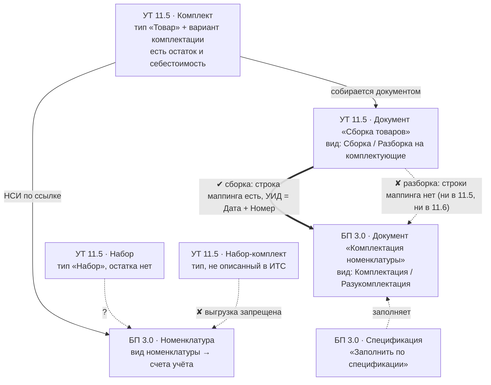

## 1. Главная карта: четыре сущности, которые путают

**Что вы узнаете.** Чем комплект отличается от набора, где живёт каждый из
четырёх объектов и почему путаница между ними ломает проект ещё на обследовании.
**Что нужно знать заранее.** Ничего, кроме общего представления о справочнике
номенклатуры.

В этом контуре **четыре** разных объекта, а не один. Половина проектов «учёта
комплектов» ломается потому, что заказчик хочет «чтобы комплект был», а под этим
подразумевает в разные минуты разные из четырёх.

| | **[Комплект](terminy/komplekt.html)** | **[Набор](terminy/nabor.html)** (динамический) | **[Набор-комплект](terminy/nabor-komplekt.html)** | **Комплектация номенклатуры** |
|---|---|---|---|---|
| Где живёт | УТ 11.5 | УТ 11.5 | УТ/КА/ERP | БП 3.0 |
| Это | номенклатура типа `Товар` + **[вариант комплектации](terminy/variant-komplektacii.html)** | номенклатура типа `Набор` | тип номенклатуры | **документ** (2 вида операции) |
| Физическая сборка на складе | **да**, документом `Сборка товаров` | **нет** | — | да, документом |
| Остаток на складе | есть, как у обычного товара | **нет** (лежат комплектующие) | — | есть |
| Себестоимость/цена | комплект = сумма себестоимостей комплектующих | цена **складывается из цен комплектующих** (или распределяется) | — | по **сумме себестоимостей**; обратно — **долей** |
| Перенос в БП | документом `Сборка товаров → Комплектация номенклатуры` | **в ИТС не описан** | **запрещён** | это и есть БП-сторона |

Цитаты-опоры:

> «Информация о комплекте заполняется в справочнике Номенклатура. **Для комплекта
> используется тип номенклатуры Товар**.» — `ut8doc/339` (релиз 11.5.22, ваш)

> «**Набор – комплекты, которые не хранятся на складе, а собираются в процессе
> отгрузки.**» — `ut115doc/798` (программная документация УТ 11.5)

> «**Комплектация – объединение нескольких товаров в один комплект. Разукомплектация
> – разделение комплекта на отдельные товары.**» — `bp8doc/160`

> «**НЕ поддерживается выгрузка из ERP (КА, УТ) элементов справочника Номенклатура
> с типом Набор-комплект.**» — `ut115doc/1585`

Архитектурная формулировка, которую стоит повесить над рабочим столом:

* **в УТ комплект — это складская операция** (нужен документ сборки, появляется
  остаток и себестоимость);
* **в УТ набор — это способ продажи и ценообразования** (никакого объекта склада
  не возникает);
* **в БП «набора» нет вообще** — там только бухгалтерская операция комплектации.

Отдельно — слова, которые звучат похоже и из-за этого путаются в переписке с
заказчиком и в постановке задачи:

| Слово | Что это на самом деле | Где живёт | Как отличить на практике |
|---|---|---|---|
| **Вариант комплектации** | именованный состав комплектующих внутри одного комплекта; один вариант помечен основным | УТ 11.5, карточка номенклатуры-комплекта (`ut8doc/339`) | у одного комплекта их может быть несколько; это не отдельная номенклатура |
| **Состав набора** | список комплектующих динамического набора | УТ 11.5, настройка **вида номенклатуры** ([§3.2](03-ut-nabory.html#3.2)) | не документ и не справочник: правится в настройках вида |
| **Спецификация** | самостоятельный справочник БП, по которому заполняется документ комплектации | БП 3.0 ([§4.3](04-bp-komplektaciya.html#4.3), `bp8doc/165`) | в УТ для сборки не нужна; в БП — обязательный шаг настройки |
| **Комплектация номенклатуры** | бухгалтерский **документ** с двумя видами операции | БП 3.0 (`bp8doc/160`) | это не «вид номенклатуры» и не «состояние склада» |
| **Набор-комплект** | тип номенклатуры, который в обмене существует только как запрет | УТ/КА/ERP ([§5.5](05-perenos-dannyh.html#5.5)) | позиция с таким типом в БП просто не уедет |

---

**Термины этой главы** (пояснения — в [словаре](terminy/index.html)): [Комплект](terminy/komplekt.html) · [Динамический набор](terminy/nabor.html) · [Набор-комплект](terminy/nabor-komplekt.html) · [Вариант комплектации](terminy/variant-komplektacii.html) · [Вид номенклатуры](terminy/vid-nomenklatury.html) · [Спецификация](terminy/specifikaciya.html) · [Разукомплектация](terminy/razukomplektaciya.html).
