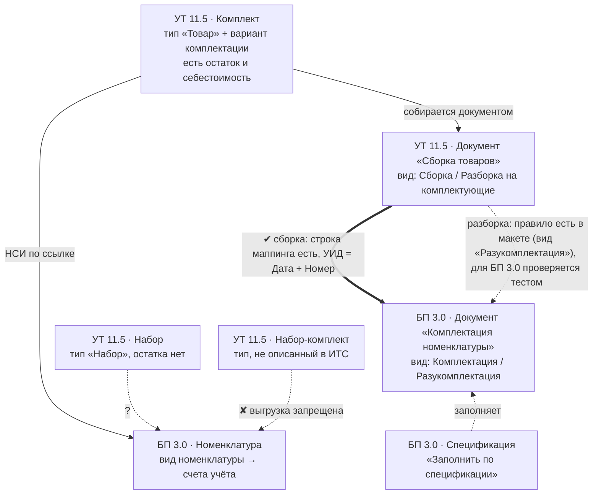

## 1. Главная карта: четыре сущности, которые путают

**Что вы узнаете.** Чем комплект отличается от набора, где живёт каждый из
четырёх объектов и почему путаница между ними ломает проект ещё на обследовании.
**Что нужно знать заранее.** Ничего, кроме общего представления о справочнике
номенклатуры.

Представьте совещание. Коммерческий директор говорит: «Нам нужны комплекты».
Склад добавит: «Чтобы лежали готовые». Бухгалтер поправит: «И чтобы себестоимость
была видна». Программист кивнёт и уйдёт настраивать. А через месяц выяснится,
что трое участников имели в виду три разных объекта, и ни один из них не совпал
с четвёртым, который есть в программе.

Это не редкий случай, а норма. В контуре «Управление торговлей + Бухгалтерия
предприятия» живут **четыре** разные сущности, и слово «комплект» в разговоре
может означать любую из них. Половина проектов «учёта комплектов» ломается
именно здесь: не на коде, а на согласовании терминов. Поэтому сначала — карта,
потом всё остальное.

| | **[Комплект](terminy/komplekt.html)** | **[Набор](terminy/nabor.html)** (динамический) | **[Набор-комплект](terminy/nabor-komplekt.html)** | **Комплектация номенклатуры** |
|---|---|---|---|---|
| Где живёт | УТ 11.5 | УТ 11.5 | УТ/КА/ERP | БП 3.0 |
| Это | номенклатура типа `Товар` + **[вариант комплектации](terminy/variant-komplektacii.html)** | номенклатура типа `Набор` | тип номенклатуры | **документ** (2 вида операции) |
| Физическая сборка на складе | **да**, документом `Сборка товаров` | **нет** | — | да, документом |
| Остаток на складе | есть, как у обычного товара | **нет** (лежат комплектующие) | — | есть |
| Себестоимость/цена | комплект = сумма себестоимостей комплектующих | цена **складывается из цен комплектующих** (или распределяется) | — | по **сумме себестоимостей**; обратно — **долей** |
| Перенос в БП | документом `Сборка товаров → Комплектация номенклатуры` | **в ИТС не описан** | **запрещён** | это и есть БП-сторона |

Цитаты-опоры:

> «Информация о комплекте заполняется в справочнике Номенклатура. **Для комплекта
> используется тип номенклатуры Товар**.» — `utovio/339` (релиз 11.5.22, ваш)

> «**Набор – комплекты, которые не хранятся на складе, а собираются в процессе
> отгрузки.**» — `ut115doc/798` (программная документация УТ 11.5)

> «**Комплектация – объединение нескольких товаров в один комплект. Разукомплектация
> – разделение комплекта на отдельные товары.**» — `bp8doc/160`

> «**НЕ поддерживается выгрузка из ERP (КА, УТ) элементов справочника Номенклатура
> с типом Набор-комплект.**» — `ut115doc/1585`

Разберём эту таблицу по-человечески, потому что от неё зависит вся дальнейшая
работа.

**Комплект — это складская операция.** Пока комплект не собран, на складе лежат
отдельные части: стол, стулья, тумба. В момент сборки части списываются, а
вместо них появляется одна позиция «Гарнитур». У неё есть остаток, её можно
пересчитать, у неё своя себестоимость. Для программы комплект — обычный товар,
просто с записью «из чего он состоит». Именно поэтому он попадает во все
товарные отчёты и не требует отдельного учёта.

**Набор — это способ продажи.** «Гарнитур под заказ» на складе не лежит: лежат
комплектующие, и только в момент отгрузки программа показывает клиенту одну
строку «Гарнитур», а со склада списывает части. Остатка у набора нет по
определению. Отсюда и слово «динамический»: состав формируется в процессе
продажи, а не заранее. Для бухгалтерии это принципиально: набора там нет
вообще, есть только строки товаров и суммы.

**Набор-комплект — это ловушка, а не инструмент.** Тип номенклатуры с таким
названием встречается в старых базах и в чужих конфигурациях. В обмене с
бухгалтерией он запрещён: позиция с этим типом просто не уедет. Если вы
увидели его в проекте — это не «ещё один вариант комплекта», а место, которое
надо переделать.

**Комплектация номенклатуры — это документ бухгалтерии.** Он не «вид
номенклатуры» и не «состояние склада». Это бухгалтерская операция с двумя
видами: собрать или разобрать. В торговле такого документа нет; там сборкой
занимается «Сборка товаров». Один и тот же физический процесс в двух базах
называется по-разному — и это первая причина, по которой при обмене возникает
вопрос «а что именно приехало».

Архитектурная формулировка, которую стоит повесить над рабочим столом:

* **в УТ комплект — это складская операция** (нужен документ сборки, появляется
  остаток и себестоимость);
* **в УТ набор — это способ продажи и ценообразования** (никакого объекта склада
  не возникает);
* **в БП «набора» нет вообще** — там только бухгалтерская операция комплектации.

Почему это важно для денег, а не только для терминов? Потому что от выбора
зависит, где возникнет остаток. Если назвать набором то, что должно лежать на
складе, склад покажет пустоту, а продажи будут списывать комплектующие, которых
никто не собирал. Если назвать комплектом то, что продаётся россыпью, на складе
появится «гарнитур», которого физически нет, и завышенный остаток. Обе ошибки
стоят одинаково дорого и обе выясняются в конце месяца, когда исправлять уже
поздно.

Отдельно — слова, которые звучат похоже и из-за этого путаются в переписке с
заказчиком и в постановке задачи:

| Слово | Что это на самом деле | Где живёт | Как отличить на практике |
|---|---|---|---|
| **Вариант комплектации** | именованный состав комплектующих внутри одного комплекта; один вариант помечен основным | УТ 11.5, карточка номенклатуры-комплекта (`utovio/339`) | у одного комплекта их может быть несколько; это не отдельная номенклатура |
| **Состав набора** | список комплектующих динамического набора | УТ 11.5, настройка **вида номенклатуры** ([§3.2](03-ut-nabory.html#3.2)) | не документ и не справочник: правится в настройках вида |
| **Спецификация** | самостоятельный справочник БП, по которому заполняется документ комплектации | БП 3.0 ([§4.3](04-bp-komplektaciya.html#4.3), `bp8doc/165`) | в УТ для сборки не нужна; в БП — обязательный шаг настройки |
| **Комплектация номенклатуры** | бухгалтерский **документ** с двумя видами операции | БП 3.0 (`bp8doc/160`) | это не «вид номенклатуры» и не «состояние склада» |
| **Набор-комплект** | тип номенклатуры, который в обмене существует только как запрет | УТ/КА/ERP ([§5.5](05-perenos-dannyh.html#5.5)) | позиция с таким типом в БП просто не уедет |

На этой таблице стоит остановиться ещё раз. «Вариант комплектации» и
«спецификация» кажутся одним и тем же — состав изделия. Но живут они в разных
базах, правятся разными людьми и не синхронизируются автоматически. Это не
дублирование «по недосмотру», а два независимых объекта, и проект, который
этого не учёл, рано или поздно получит расхождение: торговля разбирает комплект
по новому составу, бухгалтерия — по старому.

Схема читается так: слева — торговля, справа — бухгалтерия, стрелки — то, что
реально происходит с объектами. Сплошная стрелка означает подтверждённый
механизм, пунктир — место, где нужно проверять. Обратите внимание: от набора
в бухгалтерию ведёт знак вопроса. Это не опечатка и не недоделка книги: так
устроена документация, и дальше мы разберём, что с этим делать
([§5.6](05-perenos-dannyh.html#5.6)).

### 1.1. Сквозной пример: «Гарнитур „Ольха“»

Дальше по книге один и тот же гарнитур встречается в двух видах. Так удобнее:
видно, что разница между комплектом и набором не в мебели, а в учётном объекте.

**Комплект.** Номенклатура `Гарнитур «Ольха» СТ-3`, тип `Товар`, вариант комплектации
«Ольха-3» — основной. Состав варианта:

| Комплектующая | Количество | Себестоимость, ₽ | Доля стоимости, % |
|---|---|---|---|
| Стол «Ольха» (основная комплектующая) | 1 | 8 000 | 40 |
| Стул «Ольха» | 4 | 2 200 | 40 |
| Тумба «Ольха» | 1 | 4 500 | 20 |
| **Комплект целиком** | 1 | **21 300** | 100 |

Собирается 05.10.2026 документом `Сборка товаров`, вид `Сборка`; продаётся за
33 000 ₽.

**Набор.** Номенклатура `Гарнитур «Ольха» под заказ», тип `Набор`: тот же состав плюс
работа «Сборка на дому» — в комплект работу положить нельзя, в набор можно (§3.4).
Остатка на складе нет: лежат только комплектующие, а цена набора либо складывается из
их цен, либо задаётся фиксированной (`ut115doc/798`).

Что с этим примером происходит по главам:

| Глава | Что происходит | Куда смотреть |
|---|---|---|
| [2](02-ut-komplekty.html) | комплект заводят, собирают и при необходимости разбирают | [§2.3](02-ut-komplekty.html#2.3) сборка, [§2.4](02-ut-komplekty.html#2.4) доли и основная комплектующая |
| [3](03-ut-nabory.html) | набор того же гарнитура заводят как `Набор`; состав живёт в виде номенклатуры | [§3.2](03-ut-nabory.html#3.2), [§3.4](03-ut-nabory.html#3.4) |
| [4](04-bp-komplektaciya.html) | в БП та же сборка выглядит как `Комплектация номенклатуры` на 21 300 ₽ | [§4.2](04-bp-komplektaciya.html#4.2) формула, [§4.5](04-bp-komplektaciya.html#4.5) проводки |
| [5](05-perenos-dannyh.html) | сборка и разборка уезжают по правилу в коде БП; проверяется срабатывание в узле; продажа набора приезжает строками комплектующих | [§5.3](05-perenos-dannyh.html#5.3), [§5.4](05-perenos-dannyh.html#5.4), [§5.6](05-perenos-dannyh.html#5.6) |
| [6](06-skvoznye-temy.html) | ГТД и страна происхождения комплекта берутся от стола; после разборки появляются партии комплектующих по долям | [§6.1](06-skvoznye-temy.html#6.1), [§6.3](06-skvoznye-temy.html#6.3), [§6.5](06-skvoznye-temy.html#6.5) |
| [7](07-metodika-i-testy.html) | на этом же примере прогоняются тесты ТК-1…ТК-4 и заполняется протокол | [§7.3](07-metodika-i-testy.html#7.3) |

Числа в примере условные; важны не они, а последовательность: комплект получает
себестоимость **один раз при сборке**, а при разборке она **распределяется по
долям** — и именно это распределение чаще всего расходится между УТ и БП.
Следите за одним числом: 21 300 ₽. Оно появится при сборке, оно же должно
разложиться на 8 520 + 4×2 130 + 4 260 при разборке. Если в бухгалтерии
получилось другое — где-то разошлись доли, и это первое, что нужно проверить.

**Что запомнить из этой главы.**

1. «Комплект» и «набор» — не синонимы и не настройки одной сущности: это разные
   объекты с разным поведением склада.
2. Комплект живёт в торговле как товар с составом; набор — как способ продажи
   без остатка; в бухгалтерии есть только документ комплектации.
3. Состав комплекта хранится в двух базах по-разному и автоматически не
   синхронизируется — это главный источник расхождений.
4. Тип «Набор-комплект» в обмене запрещён; увидели — переделывайте.

Дальше — как комплект заводят, собирают и разбирают в торговле.

---

**Термины этой главы** (пояснения — в [словаре](terminy/index.html)): [Комплект](terminy/komplekt.html) · [Динамический набор](terminy/nabor.html) · [Набор-комплект](terminy/nabor-komplekt.html) · [Вариант комплектации](terminy/variant-komplektacii.html) · [Вид номенклатуры](terminy/vid-nomenklatury.html) · [Спецификация](terminy/specifikaciya.html) · [Разукомплектация](terminy/razukomplektaciya.html).
