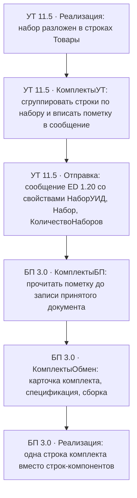

<a name="11"></a>

## 11. Приложение. Комплект расширений: КомплектыОбмен, КомплектыБП, КомплектыУТ

**Что вы узнаете.** Как устроен готовый комплект расширений, который прогонялся
на копиях наших баз: из чего он состоит, как ставится, чем управляется и что
делает с принятым из обмена документом. Это практикум к [§5.13](05-perenos-dannyh.html#5.13)
(модель «одна карточка — спецификация и сборка на каждую продажу») и к
[главе 10](10-rasshirenie-formata.html) (как пометка набора доезжает до БП).

**Что нужно знать заранее.** Главы 4 и 5: комплект в БП, наборы в УТ и точку
стыка. Из главы 10 достаточно помнить вывод: типовой обмен ED не везёт состав
набора, и носитель пометки добавляет расширение формата.

Всё, что здесь описано, собиралось и прогонялось на копиях `DemoBPprof` /
`DemoTrd` 05–06.11.2026; протоколы — [установка](https://github.com/grevinden/komplekty-ut-bp/blob/main/cfg/EVIDENCE-2026-11-05-ext-install.md),
[сквозной обмен](https://github.com/grevinden/komplekty-ut-bp/blob/main/cfg/EVIDENCE-2026-11-05-cross-ut-bp.md),
[сборка .cfe](https://github.com/grevinden/komplekty-ut-bp/blob/main/cfg/EVIDENCE-2026-11-05-cfe-build.md),
[журнал, менеджер записи, повтор](https://github.com/grevinden/komplekty-ut-bp/blob/main/cfg/EVIDENCE-2026-11-06-dorabotka.md),
[пометка в сообщении](https://github.com/grevinden/komplekty-ut-bp/blob/main/cfg/EVIDENCE-2026-11-06-pometka-wire.md).
Исходники и готовые файлы — в репозитории, `tools/1c/ext/`.

<a name="11.1"></a>
### 11.1. Почему расширений три, а не одно

Комплект разрезан по границе «знание о предмете / знание о конкретной
конфигурации»:

- **КомплектыОбмен** — ядро. Ни одного заимствованного объекта: только свои
  общие модули, два регистра сведений и XDTO-пакет расширения формата.
  Одинаковое, ставится в **обе** базы пары.
- **КомплектыБП** и **КомплектыУТ** — адаптеры. В них живёт всё, что зависит
  от конкретной конфигурации: заимствованные менеджеры обмена с перехватчиками,
  а на стороне БП — журнал обработки и состояние обработки.

Причина разреза — та же, по которой в главе 10 заимствуются менеджеры обмена:
модуль-перехватчик привязан к имени объекта конфигурации, а оно в УТ и БП
разное (`МенеджерОбменаЧерезУниверсальныйФормат` против `…13`). Ядро при этом
остаётся общим — если появится третья конфигурация (например КА), для неё
пишется только адаптер. У каждого расширения свой префикс имени
(`КомплектыОбмен_`, `КомплектыБП_`, `КомплектыУТ_`) и режим совместимости
`Version8_3_27`; версии всех трёх — `1.0.0.1`. Ядро отдаёт её через
`КомплектыОбмен_Сервер.Версия()`, а наличие конфигурации проверяет
`СведенияОКонтуре()`; оба метода — диагностические: адаптеры их не вызывают и
совместимость по номеру версии не сверяют. При рассинхроне сборок ориентир —
одинаковый номер в метаданных всех трёх расширений.



<a name="11.2"></a>
### 11.2. Состав комплекта: объекты поимённо

**КомплектыОбмен** (ядро, обе базы):

| Объект | Зачем |
|---|---|
| `КомплектыОбмен_Сервер` | фасад: `Версия()`, `СведенияОКонтуре()` (есть ли в базе `КомплектацияНоменклатуры` — адаптерам не надо угадывать конфигурацию), точка входа `ОбработатьПолученныйДокумент()` |
| `КомплектыОбмен_Настройки` | чтение настроек контура и проверка даты запрета |
| `КомплектыОбмен_Пометка` | `ПрочитатьГруппы()`: сгруппировать строки `Товары` по УИД набора |
| `КомплектыОбмен_Свертка` | конвейер: пометка → карточка → спецификация → сборка → замена строк |
| `КомплектыОбмен_Карточки` | создание и поиск карточки, спецификации, сборки; снятие регистрации изменений |
| регистр `КомплектыОбмен_Настройки` | поля: `Включен`, `СоздаватьКарточки`, `ДатаЗапрета`, `Склад` (читается — склад по умолчанию для сборки), `РазделятьПоСтавкамНДС` (в регистре есть, кодом не читается — зарезервировано) |
| регистр `КомплектыОбмен_СоответствиеНаборов` | измерение `НаборУИД` → `Карточка` (плюс наименование и дата создания) |
| XDTO-пакет `КомплектыОбмен_EnterpriseData` | расширение формата, namespace `http://v8.1c.ru/edi/edi_stnd_ext_enterprisedata/EnterpriseData/1.20` (§10.2) |

**КомплектыБП** (адаптер бухгалтерии):

| Объект | Что перехвачено |
|---|---|
| `МенеджерОбменаЧерезУниверсальныйФормат13` (заимств.) | `&После ДобавитьПКО_Документ_РеализацияТоваровУслуг` — в существующее ПКО строки `Товары` добавляются свойства `КомплектыОбмен_НаборУИД`, `КомплектыОбмен_Набор`, `КомплектыОбмен_КоличествоНаборов` (имена общие для пары баз); `&После ПКО_…_ПередЗаписьюПолученныхДанных` — вызов свёртки |
| `ОбменДаннымиПереопределяемый` (заимств.) | `&После ПриПолученииДоступныхРасширенийФормата` — `РасширенияФормата.Вставить(URI, "1.20")` |
| `КомплектыБП_Обмен` (свой модуль) | обвязка свёртки: подстановка склада, журнал, пометка в комментарий; `ОбработатьПослеЗаписи()` — обработчик подписки |
| подписка `КомплектыБП_ПослеЗаписиРеализации` | `Event = OnWrite` документа `РеализацияТоваровУслуг`: пишет журнал уже после записи, когда у документа есть ссылка (до записи группы копятся в `ДополнительныеСвойства`) |
| `КомплектацияНоменклатуры`, `РеализацияТоваровУслуг` (заимств. документы) | спайк S1: проверка, что `&После` на модуле объекта заимствованного документа вообще вызывается (модуль объекта документа `КомплектацияНоменклатуры` — заглушка с комментарием); в `РеализацияТоваровУслуг` объявлены реквизиты ТЧ `Товары` `КомплектыОбмен_*` |
| перечисление `КомплектыБП_СостояниеОбработки` | `Обработан` / `Пропущен` / `Ошибка` |
| регистр `КомплектыБП_ЖурналОбработки` | измерения — принятый документ + ключ группы; ресурсы — карточка, спецификация, сборка, количество наборов, состояние, сообщение, `Обработано` (дата и время записи) |

**КомплектыУТ** (адаптер торговли): тот же `ОбменДаннымиПереопределяемый`
(регистрация расширения формата) и `&После` в
`МенеджерОбменаЧерезУниверсальныйФормат`: в ПКО-отправку строки `Товары`
встраиваются те же три свойства `КомплектыОбмен_*`, а
`ПКО_…_ПриОтправкеДанных` группирует строки по набору и пишет пометку в
таблицу значений `Товары` (колонки `КомплектыОбмен_НаборУИД`, `…_Набор`,
`…_КоличествоНаборов`) — движок обмена сам превращает их в XDTO-свойства.
Количество наборов считается по составу варианта комплектации
(`Количество` строки ÷ количество комплектующей в одном наборе, `Окр(…, 0)`,
минимум 1); при сбое чтения состава — 1 и запись в журнал регистрации.

Про заимствованные модули — правило, выстраданное на установке: модуль
расширения заимствованного объекта содержит **только аддитивные методы с
`&После`/`&Вместо`**. Копия оригинального текста внутрь CFE не переезжает;
попытка положить копию даёт конфликт при загрузке
([протокол установки](https://github.com/grevinden/komplekty-ut-bp/blob/main/cfg/EVIDENCE-2026-11-05-ext-install.md)).

<a name="11.3"></a>
### 11.3. Как устроена обработка: конвейер в пять шагов

Весь путь в БП происходит **до записи** принятого документа — документ ещё не
в базе, но уже собран из сообщения (`ПолученныеДанные`). Порядок:

1. **Подстановка склада.** ED 1.20 не передаёт склад ни в шапке, ни в строках
   `РеализацииТоваровУслуг`, а в БП 3.0 при виде операции «Товары» поле
   обязательное — без него принятый документ не проводится. Если склад в
   принятом документе пуст, адаптер берёт первый справочника по наименованию
   (в демо-базе один склад, «Основной склад», поэтому детерминированно) и
   проставляет его в шапку и в строки. Для сборки склад берётся из продажи,
   а если и там пуст — из настроек.
2. **Чтение пометки.** `КомплектыОбмен_Пометка.ПрочитатьГруппы()` проходит
   строки `Товары` и группирует их по `НаборУИД`. Пометки нет — документ
   проходит неизменным (типовой обмен не трогается вообще).
3. **На каждую группу** — свой комплект объектов (§5.13):
   * карточка комплекта: ищется в `СоответствиеНаборов` по УИД; если нет и
     `СоздаватьКарточки` — создаётся (вид «Товары», единица «шт», признак
     «Комплектуем») и привязывается к УИД;
   * спецификация «Реализация <номер> от <дата>» с составом одного набора
     (строка группы ÷ количество наборов);
   * сборка `КомплектацияНоменклатуры`: дата на секунду раньше продажи, вид
     операции «Комплектация», склад из продажи, счёт 41.01, доли
     `100 / количество комплектующих`; проводится, а не проведётся —
     остаётся записанной.
4. **Замена строк.** Строки группы сворачиваются в одну строку комплекта:
   количество = число наборов, цена = сумма группы ÷ число наборов, сумма и
   НДС — сумма группы; счёт учёта, ставка НДС, субконто и единица переносятся
   из первой строки группы, идентификатор строки — новый. Сумма документа
   пересчитывается (плюс `Услуги`, если табличная часть есть — услуги не
   сворачиваются, [ТК-15](07-metodika-i-testy.html#7.3)).
5. **Гашение обратной волны и следы.** Созданные карточка, спецификация и
   сборка снимаются с регистрации во **всех** планах обмена
   (`УдалитьРегистрацияИзменений`) — иначе БП отправила бы их обратно в УТ.
   Журнал `КомплектыБП_ЖурналОбработки` пишется **после записи** документа:
   до записи группы копятся в `ДополнительныеСвойства`, а подписка
   `КомплектыБП_ПослеЗаписиРеализации` (`OnWrite`) записывает по строке на
   группу — с документом, ключом группы и результатом. До этой правки журнал
   писался до записи, ссылка была пустой и все группы схлопывались в одну
   строку. В комментарий документа добавляется метка
   «Комплекты: обработано N групп(ы)».

Идемпотентность: повторная загрузка той же продажи сначала удаляет прежнюю
спецификацию с таким именем и прежнюю сборку (она ищется по комментарию
«Сборка под продажу …» и снимается с проведения), потом создаёт заново.
Проверено прогоном 06.11.2026: после повтора того же сообщения — 3 документа,
3 строки журнала (по одной на документ), одна спецификация и одна сборка на
документ; дублей нет. Запись журнала идёт через `СоздатьМенеджерЗаписи()`, а не
набором записей: у независимого регистра набор без отбора при `Записать()`
заменяет всю таблицу — на этой ошибке терялись строки предыдущих документов
([протокол](https://github.com/grevinden/komplekty-ut-bp/blob/main/cfg/EVIDENCE-2026-11-06-dorabotka.md),
снимки `komplekt/d13-*`).

<a name="11.4"></a>
### 11.4. Установка

Порядок и подводные камни — по
[протоколу установки](https://github.com/grevinden/komplekty-ut-bp/blob/main/cfg/EVIDENCE-2026-11-05-ext-install.md);
здесь — как повторить.

**Из готовых файлов.** В репозитории `tools/1c/ext/dist/` (размеры на
06.11.2026): `КомплектыОбмен.cfe` 31 385 б, `КомплектыБП.cfe` 26 690 б,
`КомплектыУТ.cfe` 10 983 б. Каждый собран `ibcmd config save --db` с живой
копии и проверен
обратной загрузкой и `config check`
([протокол сборки](https://github.com/grevinden/komplekty-ut-bp/blob/main/cfg/EVIDENCE-2026-11-05-cfe-build.md)).
Ставятся как любое дополнение: из управляемого интерфейса — «Добавить из
файла» в списке расширений (эту ветку мы не прогоняли), из командной строки —
`ibcmd config load` (ею и проверялись файлы). Порядок подключения любой, но
**ядро обязательно в обе базы**.

**Из XML-исходников** (для доработки):

```bash
python3 db-load-xml.py --designer /LoadConfigFromFiles \
  -Extension tools/1c/ext/КомплектыОбмен   # и т. д.
# затем, если расширение уже было подключено:
ibcmd config apply --db-path=<копия> -e КомплектыОбмен --force
```

Три правила, без которых не заведётся:

- **Снять безопасный режим** у всех трёх расширений: код ядра ходит в
  справочники и документы, в режиме «Безопасный» он падает.
- УТ-копия с аутентификацией требует `--user="Администратор"` — и только в
  `config`-режиме `ibcmd` (в `enterprise`-режиме ключ не принимается).
- Заимствованные модули — только аддитивные методы (см. §11.2).

Приёмка после установки — тестовый документ-«перехватчик» в обеих базах:
в БП он должен показать, что перехватчик менеджера сработал, в УТ — что
расширение формата зарегистрировано. На копиях обеих баз приёмка зелёная.

<a name="11.5"></a>
### 11.5. Настройки и управление

Регистр `КомплектыОбмен_Настройки` (одна запись) — единственный рубильник:

| Поле | Действие |
|---|---|
| `Включен` | выключен — свёртка не выполняется, обмен идёт как типовой |
| `СоздаватьКарточки` | выключен — неизвестный набор не создаёт карточку, а группа уходит в ошибку «Карточка не найдена, создание запрещено настройками» |
| `ДатаЗапрета` | документы раньше даты не сворачиваются (исторические продажи не плодят комплекты) |
| `Склад` | склад по умолчанию для сборок, если в продаже склад не пришёл |
| `РазделятьПоСтавкамНДС` | в регистре есть, кодом не читается — зарезервировано |

Форм у регистров нет: управление — записью регистра напрямую (Конфигуратор или
обработка). Это осознанно: комплект сейчас — отработанный прототип, а не
продуктовая поставка.

Журнал `КомплектыБП_ЖурналОбработки` — точка контроля: по строке на группу
обработки видно состояние (`Обработан`/`Пропущен`/`Ошибка`), созданные объекты,
количество наборов, текст ошибки и дату обработки (`Обработано`). Строки
привязаны к **записанному** документу: журнал пишется подпиской `OnWrite`, а не
до записи. Плюс человекочитаемая метка в комментарии самой реализации.

<a name="11.6"></a>
### 11.6. Приёмка: что доказано прогоном

Сквозной прогон 05.11.2026 на копиях с живым обменом УТ→БП
([протокол](https://github.com/grevinden/komplekty-ut-bp/blob/main/cfg/EVIDENCE-2026-11-05-cross-ut-bp.md)):

- приняты и проведены два документа: поступление (приход 98 000) и реализация
  с набором (14 130);
- в реализацию БП попала **одна строка комплекта** вместо компонентных строк;
- проводки: Дт41.01/Кт60.01 на приход; по реализации 90.02.1 ↔ 41.01 —
  12 670,09 по средней себестоимости, НДС 2 355;
- созданы карточка, спецификация и проведённая сборка; обратно в УТ они не
  уехали (регистрация изменений снята);
- повтор сообщения не создаёт двойников, но и **не перезаписывает** объект с
  совпавшей версией данных: чтобы переиграть продажу, черновик в приёмнике
  нужно удалить руками.

Повторный прогон 06.11.2026 на новой сборке расширений — продажа **двух**
наборов ([протоколы](https://github.com/grevinden/komplekty-ut-bp/blob/main/cfg/EVIDENCE-2026-11-06-dorabotka.md):
[журнал и повтор](https://github.com/grevinden/komplekty-ut-bp/blob/main/cfg/EVIDENCE-2026-11-06-dorabotka.md),
[пометка в сообщении](https://github.com/grevinden/komplekty-ut-bp/blob/main/cfg/EVIDENCE-2026-11-06-pometka-wire.md)):

- в сообщении №11 — `КомплектыОбмен_НаборУИД`, `КомплектыОбмен_Набор`,
  `КомплектыОбмен_КоличествоНаборов`; у строк проданного набора количество
  наборов = 2, имена `КомплектыБП_*` в сообщении не встречаются;
- в БП создан документ `ТД00-000005` с **одной строкой комплекта**:
  количество 2, цена 16 485, сумма 32 970 (четыре комплектующие на 28 260 в УТ);
- спецификация и сборка `0000-000045` — по одной на документ, сборка проведена;
- журнал: по строке на документ, состояние `Обработан`, `КолНаб=2`, в сообщении
  `OK`; после трёх загрузок — 3 строки, ни одна не потеряна;
- повторная загрузка того же сообщения (`ПОВТОР`, счётчик принятого сброшен
  11→10) дала 3 документа, 3 строки журнала, по одной спецификации и сборке —
  дублей нет.

Отдельно проверено то, чего прогон не требует: round-trip самих .cfe (§11.4).

<a name="11.7"></a>
### 11.7. Ограничения и что не проверялось

- **Услуги не сворачиваются**: строки `Услуги` идут мимо пометки — так и
  задумано, но набор «товары + услуга одним комплектом» не поддерживается.
- **Сборка задним числом + средняя себестоимость**: пересборка с более ранней
  датой даёт расхождение средней (в ТК-15 — минус 90 ₽ на 41.01,
  [протокол ТК-15](https://github.com/grevinden/komplekty-ut-bp/blob/main/cfg/EVIDENCE-2026-11-04-uslugi-i-srednyaya.md));
  это свойство метода оценки, не бага комплекта, но при ретроспективных
  прогонах проверяйте 41.01.
- **Склад**: в базе с несколькими складами «первый по наименованию» может
  выбрать не тот склад — положите явный склад в настройки.
- **Регламентная синхронизация** с расширением формата (без ручной
  выгрузки/загрузки через форму) не проверялась — тот же открытый вопрос, что
  в §10.6.
- **Соответствие по УИД** живёт в приёмнике: переименование набора в УТ
  не переименует карточку в БП, а новый набор — новая карточка.
- **Количество наборов — оценка по составу варианта комплектации.** Если состав
  не прочитался (нет варианта, строка комплектующей не найдена, сбой), число
  наборов принимается равным 1, а в журнал регистрации пишется сообщение
  уровня «Информация». В таком случае свёртка получит заниженное количество:
  проверяйте, что у набора заполнен вариант комплектации по умолчанию.
- **Доли стоимостей в сборке проставляются равными** (`100 / число
  комплектующих`): если компоненты заметно различаются по закупочной цене,
  себестоимость комплекта распределится не по стоимости компонентов — вручную
  заданный вес в свёртке не переносится.

<a name="11.8"></a>
### 11.8. Источники главы

- Протоколы 05.11.2026:
  [установка расширений](https://github.com/grevinden/komplekty-ut-bp/blob/main/cfg/EVIDENCE-2026-11-05-ext-install.md) ·
  [сквозной обмен УТ→БП](https://github.com/grevinden/komplekty-ut-bp/blob/main/cfg/EVIDENCE-2026-11-05-cross-ut-bp.md) ·
  [сборка и round-trip .cfe](https://github.com/grevinden/komplekty-ut-bp/blob/main/cfg/EVIDENCE-2026-11-05-cfe-build.md) ·
  [ТК-15: услуги и средняя](https://github.com/grevinden/komplekty-ut-bp/blob/main/cfg/EVIDENCE-2026-11-04-uslugi-i-srednyaya.md).
- Протоколы 06.11.2026:
  [пометка в сообщении, количество наборов](https://github.com/grevinden/komplekty-ut-bp/blob/main/cfg/EVIDENCE-2026-11-06-pometka-wire.md) ·
  [журнал, менеджер записи, повтор, сборка .cfe](https://github.com/grevinden/komplekty-ut-bp/blob/main/cfg/EVIDENCE-2026-11-06-dorabotka.md) ·
  [план доработки и статусы дефектов](https://github.com/grevinden/komplekty-ut-bp/blob/main/cfg/PLAN-2026-11-05-dorabotka.md).
- Исходники: `tools/1c/ext/КомплектыОбмен/`, `КомплектыБП/`, `КомплектыУТ/`;
  готовые файлы: `tools/1c/ext/dist/`.
- Механизм расширения формата — [глава 10](10-rasshirenie-formata.html)
  (статья [metod8dev/6013] там же); модель постобработки —
  [§5.13](05-perenos-dannyh.html#5.13); тесты — [§7.3](07-metodika-i-testy.html#7.3).

**Термины этой главы** (пояснения — в [словаре](terminy/index.html)): [Комплект](terminy/komplekt.html) · [Набор](terminy/nabor.html) · [Спецификация](terminy/specifikaciya.html) · [Сборка и разборка](terminy/sborka-razborka.html) · [EnterpriseData](terminy/obmen/05-enterprisedata.html) · [УИД](terminy/obmen/03-uid.html).
